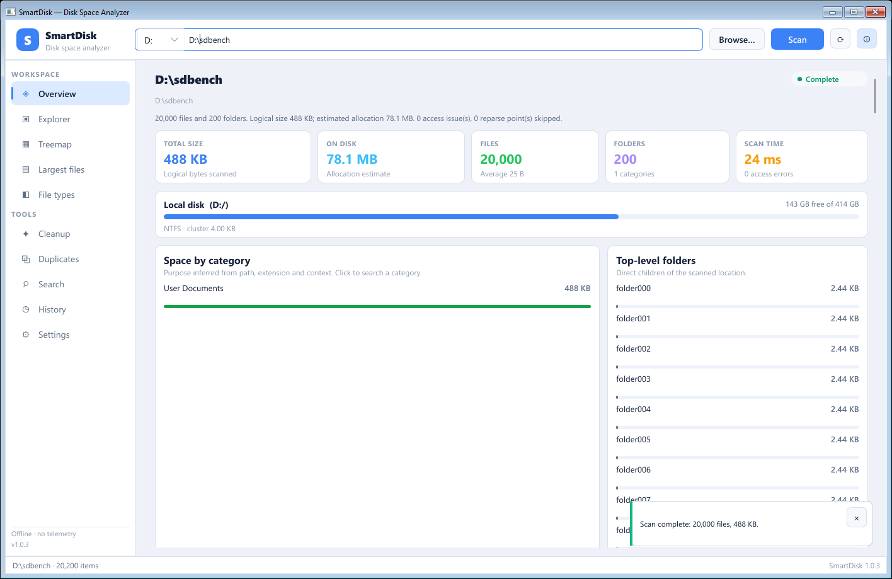
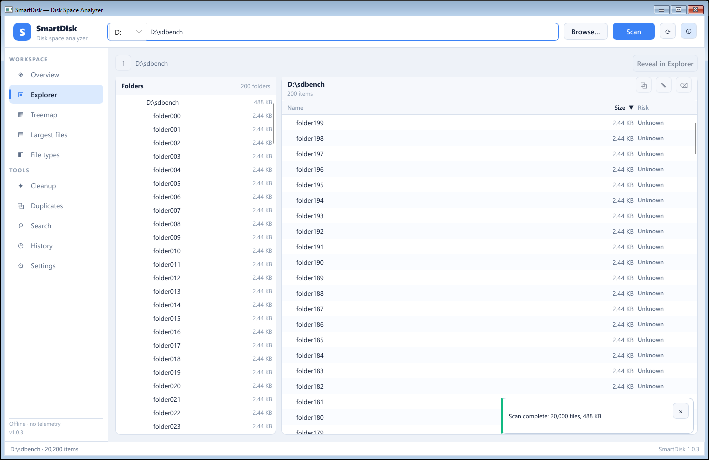
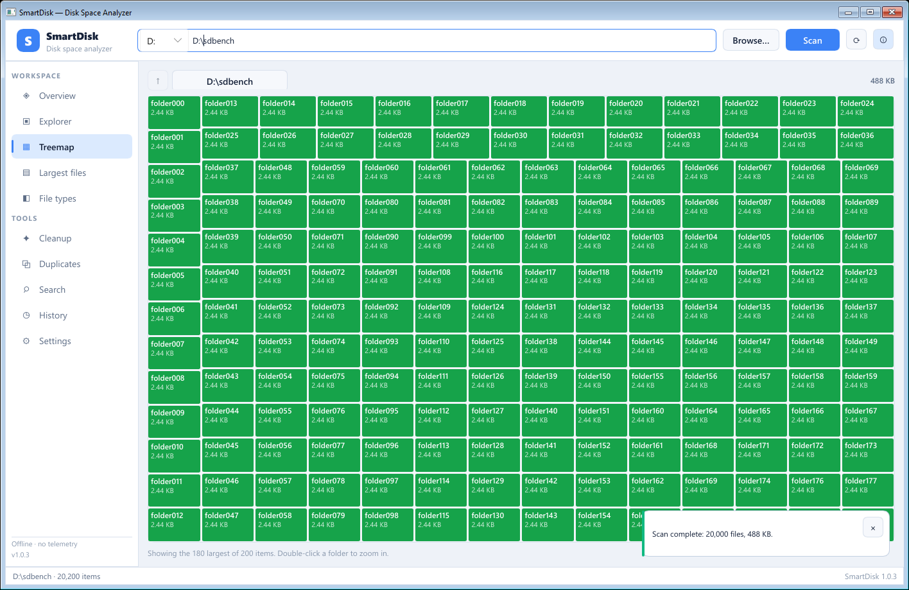

<div align="center">

# SmartDisk

### A lightweight, intelligent disk-space analyzer for Windows — that tells you what is *actually safe to delete*

**Offline · Explainable · Conservative · Native (Rust + Slint)**

[](CHANGELOG.md)
[]()
[](LICENSE)
[](TESTING.md)
[]()

</div>

---

Most disk tools answer one question: *"where did my space go?"* **SmartDisk answers the question you actually have:** *"what is all this stuff, and what can I safely delete?"*

Every file and folder is classified **offline** with visible evidence, scored by an **independent deletion-risk engine**, and cleanable only through a **previewed plan** that defaults to the Recycle Bin. Nothing is uploaded, nothing is deleted automatically, and system locations are protected by design.

> **Why it exists** — the full story, from "WizTree shows my disk but not what's safe to delete" to this app: **[STORY.md](STORY.md)**

## Screenshots

| Overview | Explorer | Treemap |
|---|---|---|
|  |  |  |

*Scanned tree: 20,000 files across 200 folders in **24 ms** (warm). See [PERFORMANCE.md](PERFORMANCE.md) for full measurements.*

## Download

**→ Grab [`SmartDisk-Setup.exe`](release/SmartDisk-Setup.exe)** (per-user installer, no admin needed) or the portable [`SmartDisk.exe`](release/SmartDisk.exe). SHA-256 hashes are in [release/checksums.txt](release/checksums.txt).

Requirements: **Windows 10 or later, x64.** The C runtime is linked statically — no Visual C++ Redistributable, no .NET, no Python, no browser, no external database. The installer is unsigned, so Windows SmartScreen may warn on first run.

## What it does

**See your disk**
- **Overview** — totals, allocated size, file/folder counts, errors, elapsed time, volume usage, largest file & folder, category share, top-level folders.
- **Explorer** — tree + details with sorting, inline actions, context menu (open, reveal, properties, copy/cut/paste, rename, Recycle Bin, permanent delete).
- **Treemap** — interactive squarified layout with breadcrumbs, zoom, and selection synced with the tree.
- **Largest files** & **File types** — the usual suspects, one click away.

**Understand it**
- **Explainable classification** — every item gets a category with a confidence score and *evidence* ("location matches a per-user temporary directory…"). Unknown stays Unknown.
- **Deletion-risk engine** — a separate, conservative engine that protects Windows, Program Files, profile and drive roots, regardless of what the classifier guessed.
- **Info panel** — what an item is, why it was classified that way, what deleting it would affect, and a recommendation.

**Clean it — safely**
- **Cleanup assistant** — groups genuinely safe candidates (temp files, caches, logs, Windows Update leftovers, Recycle Bin) with a recovery estimate.
- **Previewed plan** — review exactly what will happen before anything moves.
- **Recycle Bin by default**; permanent deletion is a separate, explicitly confirmed mode.
- **Duplicates** — optional SHA-256 duplicate detection (parallel two-stage hashing, hard-link aware), only when you ask for it.
- **Search** — global filters by name/path, category, risk, kind, size, extension, age. **History** — local SQLite scan history and recent locations.

## Safety guarantees

SmartDisk never deletes anything automatically, never deletes silently, and prefers the Recycle Bin. Permanent deletion is a separate opt-in with a second confirmation. Drive roots, user-profile roots, the Windows installation, Program Files, ProgramData\Microsoft, System Volume Information and boot areas are protected — cleanup recommendations can never target them. There is no telemetry and no network access. Full policy: [SECURITY.md](SECURITY.md).

## Performance (measured, not estimated)

| Workload | Time |
|---|---:|
| Scan 100,000 files | **71 ms** (median, release build) |
| Scan 50,000 files | 34 ms |
| Duplicate fixture, 230 MB (80 pairs + lookalikes + hard links) | **0.58 s** (2.3× faster than the 1.0.1 algorithm, identical results) |
| Startup to responsive window | ~230 ms warm |
| Idle memory | ~25 MB working set / 9 MB private |

Methodology and full tables: [PERFORMANCE.md](PERFORMANCE.md). The scanner reads directory metadata rather than the NTFS MFT (which would require elevation) — that trade-off, and its limits, are documented in [KNOWN_LIMITATIONS.md](KNOWN_LIMITATIONS.md).

## How it is built

Native **Rust** (x64, MSVC, static CRT) with a **Slint** UI and bundled **SQLite** (rusqlite). Windows integration is real Win32/Shell: `FindFirstFileExW` enumeration, `IFileOperation` for copy/move/rename, native shell delete for the Recycle Bin, `GetFileInformationByHandle` for stable file identity. Architecture and module map: [ARCHITECTURE.md](ARCHITECTURE.md).

```
src/
  scanner/       bounded-parallel metadata scanner (pause/cancel/exclusions)
  intelligence/  explainable classifier + conservative risk engine
  analysis/      aggregation, treemap, search, duplicates, file types
  cleanup/       grouped recommendations + plan validation
  file_operations/  IFileOperation ops, clipboard, explorer integration
  platform/      Win32 enumeration, drives, identity, shell
  storage/       SQLite settings/history/recents
  services/      background scan & duplicate services
  ui/            Slint controller/backend
ui/              Slint views (window, components, tables, theme)
tests/           integration suites + opt-in performance benchmarks
installer/       Inno Setup script (per-user, no admin)
tools/           build helpers and UI verification scripts
```

## Build from source

Requirements: Windows 10+ x64, Rust stable (MSVC toolchain), **Visual Studio 2022 Build Tools** with the *Desktop development with C++* workload, and optionally Inno Setup 6 for the installer.

```bat
tools\build.cmd build          :: debug build
tools\build.cmd test           :: 128-test suite (a few seconds)
tools\build.cmd build --release
"C:\Users\<you>\AppData\Local\Programs\Inno Setup 6\ISCC.exe" installer\smartdisk.iss
```

`tools\build.cmd` initializes `vcvars64.bat` and forwards arguments to Cargo. Note that `target\` is the Cargo build cache and can grow to tens of gigabytes; it is safe to delete at any time (`tools\build.cmd clean`).

## Testing

```bat
tools\build.cmd test                                          :: full suite: 128 passed / 0 failed
tools\build.cmd test --release --test performance_tests -- --ignored --nocapture --test-threads=1
powershell -NoProfile -ExecutionPolicy Bypass -File tools\measure_app.ps1
```

What was executed, on which environment, and what remains honestly **Not Verified** (code signing, Windows 10, full-volume scans, …) is recorded in [TESTING.md](TESTING.md).

## Documentation

| Document | Contents |
|---|---|
| [STORY.md](STORY.md) | Why SmartDisk exists — the problem, the motive, the methodology |
| [USER_GUIDE.md](USER_GUIDE.md) | Every page and feature, explained |
| [ARCHITECTURE.md](ARCHITECTURE.md) | Module design, scan pipeline, classification, risk, safety |
| [SECURITY.md](SECURITY.md) | Safety policy and threat model |
| [PERFORMANCE.md](PERFORMANCE.md) | Measured benchmarks and methodology |
| [TESTING.md](TESTING.md) | Verification log and known gaps |
| [KNOWN_LIMITATIONS.md](KNOWN_LIMITATIONS.md) | Honest limits |
| [CHANGELOG.md](CHANGELOG.md) | Version history |
| [release/RELEASE-NOTES.md](release/RELEASE-NOTES.md) | Per-release notes |

## Contributing & license

Issues and pull requests are welcome. By contributing you agree your work is licensed under the project's MIT license.

**MIT License** — see [LICENSE](LICENSE). © Sajidullah Khan and SmartDisk contributors.
